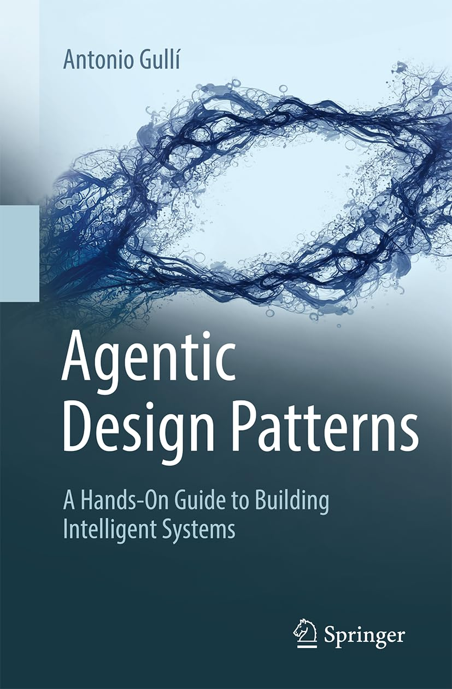

# 📚 [Book][Antonio Gulli] Agentic Design Patterns: A Hands-On Guide to Building Intelligent Systems [ENG, 2025]




**Original:**  
https://github.com/evoiz/Agentic-Design-Patterns

<br/>

## 📖 About This Repository

This repository contains the complete materials for **"Agentic Design Patterns: A Hands-On Guide to Building Intelligent Systems"** by Antonio Gulli. It includes all chapters in PDF format and accompanying code notebooks for hands-on learning.

> **Note**: All author royalties are donated to Save the Children 💝

## 🎯 What You'll Learn

This comprehensive guide covers 21 chapters and 7 appendices on building intelligent AI agent systems, including:

- **Foundational Patterns**: Prompt chaining, routing, parallelization
- **Advanced Techniques**: Reflection, tool use, planning, multi-agent systems
- **Memory & Learning**: Memory management, adaptation, goal setting
- **Production Patterns**: Exception handling, human-in-the-loop, RAG
- **Optimization**: Resource-aware patterns, reasoning techniques, guardrails
- **Real-world Applications**: From GUI to real-world environments

---

## 📚 Table of Contents

### Introduction & Foundations
- Dedication
- Acknowledgment
- Foreword
- A Thought Leader's Perspective: Power and Responsibility
- Introduction
- What makes an AI system an "agent"?

### Part One: Core Patterns (103 pages)
1. **Chapter 1**: Prompt Chaining - Sequential task decomposition
2. **Chapter 2**: Routing - Dynamic path selection
3. **Chapter 3**: Parallelization - Concurrent processing
4. **Chapter 4**: Reflection - Self-improvement mechanisms
5. **Chapter 5**: Tool Use - External capability integration
6. **Chapter 6**: Planning - Strategic task management
7. **Chapter 7**: Multi-Agent - Collaborative systems

### Part Two: Advanced Patterns (61 pages)
8. **Chapter 8**: Memory Management - State persistence
9. **Chapter 9**: Learning and Adaptation - Dynamic improvement
10. **Chapter 10**: Model Context Protocol (MCP) - Standardized interfaces
11. **Chapter 11**: Goal Setting and Monitoring - Objective tracking

### Part Three: Production Patterns (34 pages)
12. **Chapter 12**: Exception Handling and Recovery - Robust error management
13. **Chapter 13**: Human-in-the-Loop - Human-AI collaboration
14. **Chapter 14**: Knowledge Retrieval (RAG) - Information access patterns

### Part Four: Enterprise Patterns (114 pages)
15. **Chapter 15**: Inter-Agent Communication (A2A) - Agent networking
16. **Chapter 16**: Resource-Aware Optimization - Efficient resource usage
17. **Chapter 17**: Reasoning Techniques - Advanced decision-making
18. **Chapter 18**: Guardrails/Safety Patterns - Risk mitigation
19. **Chapter 19**: Evaluation and Monitoring - Performance tracking
20. **Chapter 20**: Prioritization - Task management
21. **Chapter 21**: Exploration and Discovery - Autonomous learning

### Appendices (74 pages)
- **Appendix A**: Advanced Prompting Techniques
- **Appendix B**: AI Agentic: From GUI to Real world environment
- **Appendix C**: Quick overview of Agentic Frameworks
- **Appendix D**: Building an Agent with AgentSpace
- **Appendix E**: AI Agents on the CLI
- **Appendix F**: Under the Hood: Reasoning Engines
- **Appendix G**: Coding agents

---

## 🚀 Getting Started

### Prerequisites

```bash
# Python 3.8 or higher required
python --version

# Install Jupyter for notebooks
pip install jupyter notebook

# Install common dependencies
pip install -r requirements.txt
```

### Installation

1. **Clone the repository**
```bash
git clone https://github.com/evoiz/Agentic-Design-Patterns.git
cd Agentic-Design-Patterns
```

2. **Set up virtual environment** (recommended)
```bash
python -m venv venv
source venv/bin/activate  # On Windows: venv\Scripts\activate
```

3. **Install dependencies**
```bash
pip install jupyter notebook
pip install pandas numpy matplotlib openai langchain
```

4. **Launch Jupyter Notebook**
```bash
jupyter notebook
```

## 💻 Running the Code

Each chapter includes a Jupyter notebook with practical examples:

1. Navigate to the `chapter_notebooks/` directory
2. Open the desired chapter notebook
3. Follow the instructions within each notebook
4. Run cells sequentially for best learning experience

### Example: Running Chapter 1
```python
# Navigate to notebooks directory
cd chapter_notebooks

# Launch specific notebook
jupyter notebook Chapter_01_Prompt_Chaining.ipynb
```

## 📖 How to Use This Repository

### For Self-Study
1. Read each chapter in the PDF
2. Open the corresponding notebook
3. Run the code examples
4. Experiment with modifications
5. Complete the exercises

### For Teaching
1. Use chapters as lecture materials
2. Assign notebooks as lab exercises
3. Create custom examples based on patterns
4. Build projects using multiple patterns

### For Research
1. Reference implementation patterns
2. Benchmark different approaches
3. Extend patterns for new use cases
4. Contribute improvements back

### Learning Path
1. **Beginners**: Start with Chapters 1-7 (Core Patterns)
2. **Intermediate**: Progress through Chapters 8-14 (Advanced & Production)
3. **Advanced**: Master Chapters 15-21 (Enterprise Patterns)
4. **Experts**: Explore Appendices for cutting-edge techniques


